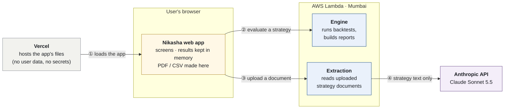
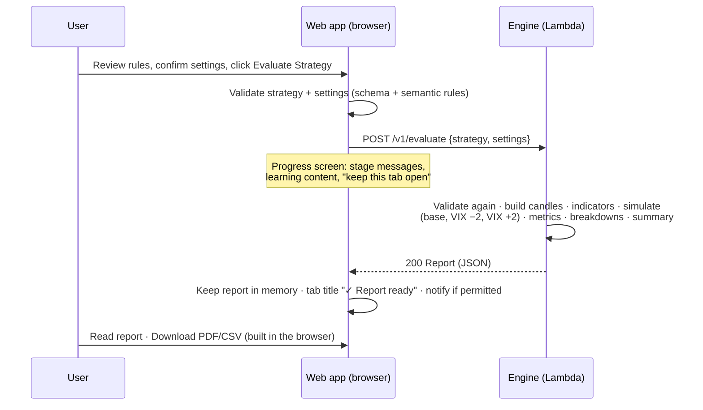
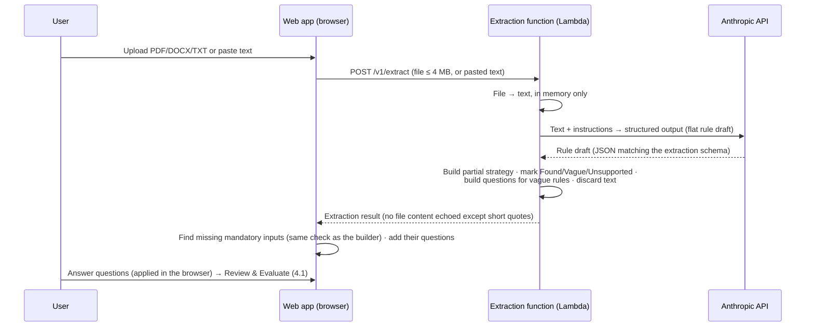

# Nikasha — Architecture

Status: **Approved 2026-10-14** · Created 2026-10-14 · Obeys [`constitution.md`](constitution.md) and [`product.md`](product.md)

This file is the big picture: the parts of the system, how they talk, where data flows, and how it is deployed. Cross-cutting frontend detail is in [`frontend.md`](frontend.md), backend detail in [`backend.md`](backend.md), and every interface between parts is defined in [`contracts/`](contracts/).

---

## 1. System overview

Read left to right. Each box is one place; each arrow is the only kind of traffic between two places.



| Arrow | What travels | Endpoint |
|---|---|---|
| ① | The app's pages and code, once at page load. Nothing goes back to Vercel | — |
| ② | Strategy + settings → report | `GET /v1/meta`, `POST /v1/evaluate`, `POST /v1/suggestions/plan` |
| ③ | Uploaded file or pasted text → rules found + questions | `POST /v1/extract` |
| ④ | The strategy text only (no file name, no user details). **The only link to Anthropic** | Anthropic Messages API |

Both AWS functions have their own Function URL; in production, CORS is limited to the Vercel domain (§3.2). The engine is a container image with the market data inside it; the extraction function is a small zip package and is the only part holding the Anthropic API key.

| Part | Runs on | Responsibility | Stores anything? |
|---|---|---|---|
| **Web app** | Browser (static files served by Vercel) | All screens; builder; review; plain-English rendering of rules; client-side validation; finding missing inputs and asking for them; orchestrating engine calls; charts; PDF/CSV export | Only in tab memory; the disclaimer flag in `localStorage` |
| **Extraction function** | AWS Lambda (Python, zip package) | Read an uploaded file into text in memory; call the LLM; turn its output into a rule draft with Found / Vague / Unsupported items and questions for vague rules | No. Nothing written to disk, logs or any store |
| **Engine** | AWS Lambda (container image) | Load and check data; expiry calendar; indicators; conditions; option pricing; backtest; report; suggestion planning | No. Read-only data baked into the image; no writes |
| **Anthropic API** | Anthropic | Interpret free-text strategy wording into structured candidate rules | Per Anthropic's API policy: inputs/outputs deleted within 30 days (disclosed, `product.md` §11.1) |

There is **no database, no object storage, no queue, no cache service and no user accounts** anywhere (constitution §5).

## 2. Repository layout

Everything lives in one GitHub repository; nothing exists only in AWS or Vercel.

```
nikasha/
├── specs/                    Single source of truth (this folder)
│   └── contracts/            api.openapi.yaml · strategy.schema.json · instrument.schema.json
│                             · strategy-rules.md · advanced-options.json · banned-phrases.txt
│                             · excluded-names.sha256 · fixtures/ (strategies, meta, reports,
│                               extraction, suggestions — shared by web and backend tests)
├── instruments/              Instrument profiles, e.g. nifty50.json (validated against the schema)
├── data/                     Clean CSVs (committed) + data README + cleaning_report.json
├── samples/                  Sample strategy documents used by tests
├── engine/                   Python engine: package, tests, Dockerfile, scripts/csv_to_parquet.py
├── extractor/                Python extraction function: package, tests, recorded LLM responses
├── pylib/                    Small Python packages shared by engine and extractor (e.g. nikasha_log)
├── scripts/                  Repo checks and helpers (README disclaimer sync, name check, privacy marker test)
├── web/                      Next.js app (static pages and client code only; no server routes)
├── infra/                    AWS SAM template (both Lambda functions, Function URLs, log groups, budget alert)
└── .github/workflows/        CI: tests, contract checks
```

**Contracts are consumed, never copied by hand.** Both sides generate code from `specs/contracts/` at build time:
- Web: TypeScript types (from the JSON Schemas and OpenAPI) and a compiled validator for `strategy.schema.json`.
- Engine and extractor: pydantic models (from the JSON Schemas) and a JSON-Schema validator using the same file.
- A CI check fails if generated code is out of date with the contracts.

## 3. How frontend and backend talk

### 3.1 Interfaces

All defined in [`contracts/api.openapi.yaml`](contracts/api.openapi.yaml).

| Endpoint | Host | Called when | Purpose |
|---|---|---|---|
| `GET /v1/meta` | Engine | App load (once per tab) | Data date range (read from the data), instrument summary (lot size pre-fill, strike interval, expiry types and availability), pre-filled costs with sources, default periods, overfitting split, data-gap summary |
| `POST /v1/evaluate` | Engine | **Evaluate Strategy**; each what-if; each suggestion variant | Run one backtest (plus the ±2 VIX sensitivity) and return the full report data |
| `POST /v1/suggestions/plan` | Engine | After a report, when the user clicks **Show ideas** | Return edited copies of the strategy to evaluate, each with a plain-English description of the change and the reason it was suggested |
| `POST /v1/extract` | Extraction function | Document upload or pasted text | Return rule items (Found / Vague / Unsupported), a partial strategy and questions for vague rules. Missing mandatory inputs are found and asked in the browser by the same check the builder uses |

### 3.2 Direct browser → Lambda calls

The browser calls both Lambda Function URLs (engine and extraction) directly; Vercel only serves static files:
- avoids Vercel function duration limits on long backtests and LLM calls;
- user content never reaches Vercel, so there is one platform to audit for privacy;
- Function URL limits fit: 6 MB request/response (buffered), up to 15 min runtime.

**CORS:** in **production**, both URLs allow only the production Vercel domain. The **dev-stage** functions allow any origin (`*`) so that Vercel preview deployments (whose addresses change per branch) and `localhost` can call them; dev functions hold nothing and are used only by the owner (owner decision, 2026-10-14). CORS protects browsers, not the endpoints, so both are **public, unauthenticated, stateless** endpoints. For the extraction URL, the Anthropic monthly spend limit caps what misuse could cost. Accepted risk for an educational MVP, mitigated by: strict request validation and size limits; caps on period length and variant counts; the account-level Lambda concurrency limit (and reserved concurrency if the account quota allows); an AWS budget alert; no data of value to steal (nothing is stored).

### 3.3 Orchestration of multiple runs

**Each backtest or variant is one engine call** (brief §3). The browser orchestrates:
- **Evaluate:** 1 call.
- **What-if slider:** 1 call per settled slider value (debounced; an in-flight call is cancelled when a new value arrives).
- **Suggestions:** 1 `plan` call, then 1 `evaluate` call per variant, run in parallel with a **concurrency cap of 4**.
- **Throttling:** on HTTP 429/503 (common on new AWS accounts with low concurrency quotas), retry with exponential backoff and jitter (1 s, 2 s, 4 s; max 3 retries), then show a plain-English "busy, try again" message.

### 3.4 Versioning

- API paths are versioned (`/v1/...`). A breaking contract change creates `/v2` or is coordinated in one release (frontend and engine are deployed together for the MVP).
- `strategy.schema.json` carries `schema_version`; the engine rejects versions it doesn't know.
- Every response carries `engine_version` (git commit SHA), shown in the report footer and download for traceability.

## 4. Data flows

### 4.1 Evaluate (template, builder or upload — all end here)



### 4.2 Document upload



The LLM never computes results, never picks values the user did not state, and is never called again after extraction: answers are applied by deterministic code in the browser.

### 4.3 What the user's content touches

| Content | Browser | Vercel | AWS | Anthropic |
|---|---|---|---|---|
| Uploaded file / pasted text | Yes (memory) | No | Extraction function, in memory during one request | Text only, during one request (30-day API retention) |
| Strategy & settings | Yes (memory) | No | In memory during one request | No (beyond the uploaded text) |
| Report / results | Yes (memory, until tab closes) | No | Built in memory, returned, discarded | No |
| Disclaimer acceptance | `localStorage` | No | No | No |

## 5. Deployment

### 5.1 Web (Vercel)
- Hobby plan (free; personal, non-commercial use). Connected to the GitHub repo; root directory `web/`. Production deploy from `main`; previews for branches (previews call dev-stage functions or locally run ones).
- Static hosting only: no server routes, so no user content and no secrets on Vercel.
- Environment variables (both public): `NEXT_PUBLIC_ENGINE_URL`, `NEXT_PUBLIC_EXTRACT_URL`.
- No Vercel Analytics, no Speed Insights, no log drains.

### 5.2 Engine and extraction (AWS)
- **Engine — container image** built from `engine/Dockerfile`: a provider-agnostic Python image with the AWS Lambda Runtime Interface Client added; Parquet files are generated from `data/*.csv` during the image build and baked in with `instruments/` (the CSVs themselves are not copied into the image, keeping it small). Starting configuration (tuned in `01-data-and-engine`): memory 2,048 MB, timeout 120 s.
- **Extraction — zip package** on the managed Python 3.12 runtime (small dependencies, so no container image and no image storage). Memory 512 MB (it mostly waits for the LLM), timeout 120 s.
- **`ANTHROPIC_API_KEY`** is passed to the extraction function as a Lambda environment variable from a `NoEcho` SAM parameter at deploy time (encrypted at rest by Lambda's default key). It is never committed to the repo and never sent to the browser. Secrets Manager is not used (paid service).
- **AWS SAM** template in `infra/` defines: both functions, both Function URLs (auth NONE, CORS, buffered invoke mode), a CloudWatch log group per function with **1-day retention**, and an AWS Budgets alert. No API Gateway, S3, EC2, NAT gateway or Secrets Manager.
- Region: `ap-south-1` (Mumbai).
- Deploy: `sam build && sam deploy` from a developer machine for the MVP (a GitHub Actions deploy with OIDC is a later improvement).

### 5.3 Portability
The engine core and the extraction core are each transport-agnostic: one function takes `(method, path, body)` and returns `(status, body)`. Two thin adapters call each:
- **Lambda adapter** (Function URL event ↔ core);
- **HTTP adapter** (a small ASGI server) for local development and for hosts such as Cloud Run.

Moving hosts means swapping the adapter entry point and deploy config; no engine code changes.

### 5.4 Environments

| Environment | Web | Engine |
|---|---|---|
| Local | `next dev` on `localhost:3000` | Engine HTTP adapter on `localhost:8000`, extraction on `localhost:8001` |
| Dev | Vercel preview or `next dev` | Lambdas `nikasha-engine-dev`, `nikasha-extract-dev` (CORS: any origin, dev only) |
| Prod | Vercel production | Lambdas `nikasha-engine-prod`, `nikasha-extract-prod` (CORS: production domain only) |

## 6. Hosting limits and how the design respects them

| Limit | Value | Design response |
|---|---|---|
| AWS Free plan | Account closes 6 months after creation or when credits run out | Accepted. Engine is portable (§5.3); everything is in GitHub |
| Lambda free usage | 1M requests + 400,000 GB-s per month | At 2 GB × ~30 s ≈ 60 GB-s per evaluation → ~6,600 evaluations/month free |
| Lambda per invocation | ≤ 15 min, ≤ 10,240 MB (new accounts may be capped lower); image ≤ 10 GB | Target ≤ 30 s per evaluate; image well under 1 GB |
| New-account concurrency | Can be as low as 10, shared by both functions | Browser concurrency cap 4; retry with backoff (§3.3) |
| Function URL payload | 6 MB request and response (buffered); binary uploads arrive base64-encoded (+33%) | Upload limit 4 MB (≈ 5.4 MB encoded); report sized well under the limit (`backend.md` §8) |
| No free API Gateway, S3, EC2 | — | Not used |
| Cost control | — | AWS budget alert from day one; Anthropic monthly spend limit set in its console |

## 7. Security and privacy architecture

- **Zero storage** (constitution §5): no data stores exist to misconfigure. The engine image is read-only data plus code.
- **Logging:** request bodies are never logged on either platform. Logs carry only technical fields (request id, endpoint, duration, status, error code). Rules in `backend.md` §7.
- **Secrets:** only `ANTHROPIC_API_KEY`, held as an encrypted environment variable of the extraction Lambda (§5.2). Vercel holds no secrets.
- **Browser:** strict Content-Security-Policy (`connect-src` limited to the site itself, the engine URL and the extraction URL); no third-party scripts, fonts or analytics at runtime; fonts self-hosted.
- **Prompt injection:** uploaded text is treated as data. The extraction prompt says so, the output is constrained to a schema, and every extracted rule is shown to the user for confirmation before anything runs.
- **Input limits:** upload ≤ 4 MB; pasted text ≤ 20,000 characters; strategy ≤ 4 legs and bounded condition depth; period inside the data range.

## 8. Cross-cutting decisions

| # | Decision | Reason |
|---|---|---|
| A1 | JSON Schema (draft 2020-12) files are the single source of truth for the strategy and instrument formats; OpenAPI 3.1 references them | Both languages can generate types and validate against the same files |
| A2 | Semantic rules that JSON Schema cannot express are listed once in `contracts/strategy-rules.md` with IDs, and shared fixtures prove both sides agree | Prevents the browser and engine from disagreeing about validity |
| A3 | Browser calls both Lambda functions (engine and extraction) directly | §3.2 |
| A4 | Reports are computed entirely in the engine; the browser only formats and renders | One place for numbers; the PDF matches the screen |
| A5 | Plain-English rule text is produced in the browser from the strategy by fixed sentence patterns; report summary sentences are produced by the engine from computed numbers by fixed patterns | Deterministic, testable, no LLM in results (no fabricated wording) |
| A6 | LLM output uses a flat (non-recursive) extraction schema, converted to the strategy format by code | Structured outputs do not support recursive schemas; conversion is deterministic and tested |
| A7 | Engine, extraction and web are released together for the MVP | One contract version in production at a time |
| A8 | Extraction runs as its own Python Lambda function, not on Vercel and not inside the engine | One backend language and platform; no Vercel time limits; Vercel never sees user content; small memory setting keeps LLM waiting cheap; engine stays focused on backtesting (owner decision, replaces the brief's Vercel-function plan) |
| A9 | Missing mandatory inputs are found and asked only in the browser, by the same check the builder and review screen use | One definition of "missing" for every entry path |

## 9. Testing at the system level

- **Contract tests:** schema files are valid; OpenAPI lints clean; shared fixtures validate identically in web and engine.
- **End-to-end (Playwright, against the local engine):** template → evaluate → report → download; upload (both samples) → questions → evaluate; builder → evaluate.
- **Deployment smoke test:** after deploy, `GET /v1/meta` returns the data range from the data, and a template evaluation succeeds through the production Function URL.
- **Privacy audit test:** after an upload and an evaluation, no user content appears in either function's CloudWatch logs (checked by searching logs for a unique marker string placed in the test strategy and upload); Vercel receives no user content at all.

## 10. Cost and local-first development

The owner does not want to spend money on hosting before MVP UAT. The design therefore runs **fully on a local machine** and deploys only onto **free tiers**.

### 10.1 Local-first
- The whole product runs locally: `next dev` (web), the engine HTTP adapter and the extraction HTTP adapter (or the engine container). No AWS account is needed to build or test.
- **Automated tests never call paid services.** Extraction tests use recorded LLM responses; live LLM calls happen only in manual tests.
- UAT can be done locally; deployment is needed only when a public URL is required (the success criteria ask for a public Vercel URL backed by Lambda).

### 10.2 Expected cost

| Item | Cost |
|---|---|
| Vercel Hobby (static hosting) | Free |
| AWS Lambda, both functions; Function URLs | Free within the always-free allowance (1M requests, 400,000 GB-s per month) |
| Container image storage (ECR), engine only | A few hundred MB; cents per month, covered by AWS Free plan credits |
| CloudWatch logs (1-day retention) | Negligible |
| AWS Budgets alert | Free |
| **Anthropic API** | **The only real spend:** a few US cents per upload; prepaid credit required |

### 10.3 Cost rules
- No paid AWS services: no API Gateway, Secrets Manager, NAT gateway, EC2, RDS or S3.
- Before the first live LLM call: an Anthropic **monthly spend limit** is set. Before the first AWS deploy: an **AWS budget alert** is set.
- Long-term hosting is decided after UAT; the portable design (§5.3) makes that a configuration change, not a rewrite.
